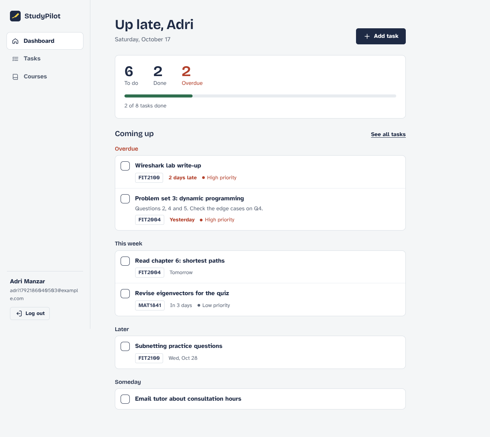

# StudyPilot

StudyPilot helps a college student keep courses, study tasks and deadlines in one place. A student creates an account, adds their courses, adds tasks (optionally linked to a course), and ticks them off as they go. The dashboard shows what's overdue, what's due today and this week, and how much is done.

Built with **MongoDB, Express, React and Node.js (MERN)** as a solo full-stack capstone.



## Features

- **Accounts** — register, log in, log out. Passwords are stored as bcrypt hashes; sessions use a signed JWT.
- **Courses** — add (name required, code optional), view, edit and delete. Each course shows how many of its tasks are done.
- **Tasks** — add with a required title and optional notes, due date, course and priority (low / medium / high). Edit, delete, and mark done or not done.
- **Filters and sorting** — filter by status (all / to do / done) and by course (including "no course"); sort by due date or recently added. Filters live in the URL, so a filtered view can be bookmarked.
- **Dashboard** — counts of to-do, done and overdue tasks, a progress bar, and upcoming work grouped into Overdue, Today, This week, Later and Someday. New students get a short explanation of what to do first.
- **Private data** — every course and task belongs to one user, and the server checks ownership on every read, update and delete. Another user's record returns `404`, the same as a missing one.
- **Responsive and accessible** — sidebar on desktop, bottom tab bar on phones; labelled form fields with linked error messages; native `<dialog>` modals; keyboard focus styles; skip link; reduced-motion support; loading, empty, success (toast) and error states on every screen.

Left out on purpose for version 1 (see the brief): teacher accounts, group work, chat, AI suggestions, file uploads, payments and push notifications.

## Project structure

```
studypilot/
├── client/                    React app (Vite)
│   ├── public/                favicon, Netlify _redirects
│   ├── src/
│   │   ├── services/api.js    every API call goes through this one module
│   │   ├── context/           AuthContext (login state), ToastContext
│   │   ├── components/        layout, forms, task row, modal, illustrations, icons
│   │   ├── pages/             Login/Register, Dashboard, Tasks, Courses, NotFound
│   │   ├── utils/dates.js     due-date labels and grouping
│   │   └── styles/index.css   all styling (design tokens at the top)
│   ├── .env.example
│   └── vercel.json            SPA rewrite for Vercel
├── server/                    Express API
│   ├── src/
│   │   ├── config/            environment variables, MongoDB connection
│   │   ├── models/            User, Course, Task (Mongoose)
│   │   ├── controllers/       auth, courses, tasks
│   │   ├── routes/            /api/auth, /api/courses, /api/tasks
│   │   ├── middleware/        requireAuth, error handling
│   │   ├── utils/             input validation, ApiError
│   │   ├── app.js             Express app (used by the server and the tests)
│   │   └── index.js           starts the server
│   ├── tests/api.test.js      end-to-end API tests
│   └── .env.example
└── docs/screenshots/
```

## Running it locally

You need **Node.js 18+** and a MongoDB database (a local MongoDB install, or a free MongoDB Atlas cluster).

### 1. API

```bash
cd server
npm install
cp .env.example .env        # then edit .env
npm run dev                 # http://localhost:5000
```

In `server/.env` set at least:

| Variable | Example | Purpose |
| --- | --- | --- |
| `MONGODB_URI` | `mongodb://127.0.0.1:27017/studypilot` | Database connection string |
| `JWT_SECRET` | a long random string | Signs login tokens. Generate one with `node -e "console.log(require('crypto').randomBytes(48).toString('hex'))"` |
| `CLIENT_ORIGIN` | `http://localhost:5173` | Frontend URL(s) allowed by CORS, comma-separated |
| `JWT_EXPIRES_IN` | `7d` | How long a login lasts |
| `PORT` | `5000` | API port |

Check it's running: open http://localhost:5000/api/health and you should see `{"status":"ok"}`.

### 2. React client

In a second terminal:

```bash
cd client
npm install
cp .env.example .env.local  # VITE_API_URL=http://localhost:5000/api
npm run dev                 # http://localhost:5173
```

### 3. Try the full journey

Register → add a course → add a task linked to it → tick it off → log out → log back in and confirm everything is still there.

## Tests

```bash
cd server
npm test
```

## API reference

All routes are under `/api`. Send JSON, and for protected routes add `Authorization: Bearer <token>`.

| Method | Route | Auth | Description |
| --- | --- | --- | --- |
| GET | `/health` | — | Health check |
| POST | `/auth/register` | — | `{ name, email, password }` → `{ user, token }` |
| POST | `/auth/login` | — | `{ email, password }` → `{ user, token }` |
| GET | `/auth/me` | ✓ | Current user |
| GET | `/courses` | ✓ | Your courses, each with `taskCounts` |
| POST | `/courses` | ✓ | `{ name, code? }` |
| GET | `/courses/:id` | ✓ | One course |
| PATCH | `/courses/:id` | ✓ | `{ name?, code? }` |
| DELETE | `/courses/:id` | ✓ | Deletes the course; its tasks are kept and unlinked |
| GET | `/tasks` | ✓ | Query: `status=pending\|completed`, `course=<id>\|none`, `sort=dueDate\|-dueDate\|newest` |
| GET | `/tasks/summary` | ✓ | Counts and next upcoming tasks. Query: `today=YYYY-MM-DD` (the student's local date) |
| POST | `/tasks` | ✓ | `{ title, description?, dueDate?, course?, priority?, status? }` |
| GET | `/tasks/:id` | ✓ | One task |
| PATCH | `/tasks/:id` | ✓ | Any task fields, e.g. `{ status: "completed" }` |
| DELETE | `/tasks/:id` | ✓ | Deletes the task |

Errors always have the same shape:

```json
{
  "error": {
    "message": "Please check the highlighted fields.",
    "details": { "title": "Give the task a title." }
  }
}
```

Example — create a task:

```bash
curl -X POST http://localhost:5000/api/tasks \
  -H "Authorization: Bearer $TOKEN" \
  -H "Content-Type: application/json" \
  -d '{"title":"Problem set 3","dueDate":"2026-10-20","priority":"high"}'
```

## Deploying

One straightforward setup (all have free tiers):

1. **Database — MongoDB Atlas.** Create a cluster and a database user, allow network access from your API host (or `0.0.0.0/0`), and copy the connection string.
2. **API — Render (or Railway).** New Web Service from the repo, root directory `server`, build command `npm install`, start command `npm start`. Set `NODE_ENV=production`, `MONGODB_URI`, `JWT_SECRET` and `CLIENT_ORIGIN` (your frontend URL, no trailing slash).
3. **Client — Vercel (or Netlify).** Import the repo with root directory `client`, framework Vite. Set `VITE_API_URL` to your API URL plus `/api`, e.g. `https://studypilot-api.onrender.com/api`. `vercel.json` (Vercel) and `public/_redirects` (Netlify) make page refreshes on `/tasks` and `/courses` work.
4. **Check the live app:** register, refresh on `/tasks`, log out and in again, and confirm in the browser's Network tab that no request goes to `localhost`.

## Design notes

The interface is meant to feel like a notebook on a desk rather than a dashboard product: cool paper background, navy "ink", and a single highlighter yellow that only marks what's due today and keyboard focus. Headings use Bricolage Grotesque; body text uses Atkinson Hyperlegible, a typeface designed for legibility. The line illustrations (desk scene, empty checklist, books, sprout, map) are hand-made inline SVGs in `client/src/components/Illustrations.jsx` and take their colours from the CSS variables.

## Known limitations and next steps

- The login token is kept in `localStorage`. That is simple and works across separate frontend/API domains, but an `httpOnly` cookie would be safer against XSS.
- No password reset or email verification yet.
- Due dates are calendar days without a time.
- No automated frontend tests yet; the UI was checked by walking the full journey on desktop and phone sizes.
- The free Render tier sleeps when idle, so the first request after a while can take several seconds.
- Ideas for later: reminders, a calendar view, recurring tasks, dark mode, and the "save for later" features from the brief once the core is stable.
